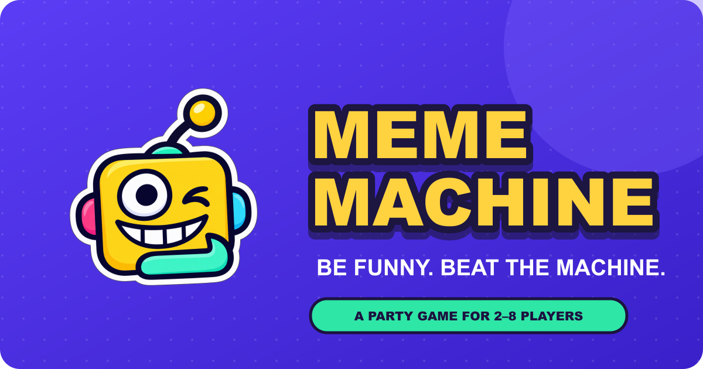

<div align="center">



# Meme Machine

### A real-time online party game where your funniest friends take the crown.

**Pick a punchline. Read the room. Beat the machine.**

[Play Meme Machine](https://memeachine.vercel.app/) · [Admin dashboard](https://memeachine.vercel.app/admin/) · [Report an issue](https://github.com/Charan3047/Meme_Machine/issues)


</div>

Meme Machine is a browser-based multiplayer party game for **2–8 players**. Everyone joins from their own phone or computer using a room code—no app download required. Play quick caption battles, make risky picks in **Don’t Copy Me**, and see who earns the highest score.

## How to play

1. One person creates a room and shares its four-letter code or invite link.
2. Friends join from their own devices. The host chooses a 4, 6, or 8 round match.
3. Play two fast party rounds:
   - **Caption Clash:** Pick one of five funny answers to a prompt. Everyone votes for the funniest caption.
   - **Don’t Copy Me:** Pick a themed option. Match the machine’s secret pick and lose points; choose something different to score.
4. Scores update after every round. The top scorer wins; the final round is worth double.

Caption Clash includes **47 built-in setups**, each with five ready-made answers. Don’t Copy Me includes **32 built-in categories**. The admin dashboard can add custom setups and categories for future matches.

## Why friends play

- **Real-time multiplayer:** Room state, picks, votes, and scores sync as the game happens.
- **Made for phones:** Responsive controls and layouts work on mobile and desktop browsers.
- **Quick to join:** Share a room code or invite link—players don’t need accounts.
- **Two ways to laugh:** Choose funny captions or try to avoid the machine’s secret pick.
- **Short matches:** Pick 4, 6, or 8 rounds.
- **Works with two:** A bot caption keeps caption voting lively in a two-player match.
- **Reconnect support:** Players can reconnect to an active room, and host rights can move to another player.
- **Admin tools:** View aggregate usage, follow recent activity, and add game content from a private dashboard.

## Run Meme Machine locally

### Requirements

- [Node.js 20 or newer](https://nodejs.org/)
- npm, included with Node.js

### Start the game

```bash
npm install
npm start
```

Open [http://localhost:3000](http://localhost:3000) on the host computer. To play with friends on the same Wi-Fi, use the **Same-Wi-Fi invite** address printed in the terminal. If Windows asks, allow Node.js through the firewall on private networks.

Local mode stores rooms in memory, so players should share the same running server. Redis is needed for the hosted Vercel deployment, where room state must be shared across serverless function instances.

## Deploy to Vercel

The app uses Vercel Functions for real-time Socket.IO connections and the admin API, with Upstash Redis for shared game rooms, analytics, and custom content.

1. Push this repository to GitHub and import it as a project in Vercel.
2. Keep the project root at the repository root. Select **Other** if asked for a framework preset. The included `vercel.json` configures the static site and API functions; no separate build command is required.
3. Create or connect an Upstash Redis database. Copy its **TCP** connection string (`rediss://...`) and add it to Vercel as `REDIS_URL`.
4. Create a long random secret for the admin dashboard and add it as `ADMIN_API_KEY`.
5. Apply the variables to **Production**. Add **Preview** too if you plan to use admin tools on preview deployments.
6. Deploy or redeploy after saving the variables.
7. Check `https://YOUR-DOMAIN/api/health`; a working deployment returns `{"ok":true,"game":"meme-machine"}`.

Treat `REDIS_URL` and `ADMIN_API_KEY` as secrets. Keep them in Vercel’s Environment Variables, not in browser code or a public GitHub commit. Vercel applies environment variable changes to new deployments, so redeploy after adding or updating them.

## Admin dashboard

Open `https://YOUR-DOMAIN/admin/` and sign in with the `ADMIN_API_KEY` configured in Vercel. The dashboard provides:

- Active browser sessions seen in the last 60 seconds
- Aggregate visitor, room, match, caption, vote, and category-pick counts
- A recent activity feed that does not show player names
- Forms to add caption setups and “Don’t Copy Me” categories

The dashboard keeps the key in page memory only and clears it when you sign out or close the page. Custom prompts and categories are saved to Redis and join the built-in content in **new matches**; matches already in progress keep their original content.

## Built with

- **Frontend:** HTML, CSS, and browser JavaScript
- **Real-time multiplayer:** Socket.IO and WebSockets
- **Server:** Node.js and Express
- **Shared state and activity data:** Upstash Redis
- **Hosting:** Vercel Functions and static deployment

## Project layout

```text
api/
  admin.js          Protected analytics and content API
  health.js         Deployment health check
  socket-io.js      Real-time game function
public/
  admin/index.html  Admin dashboard
  index.html        Player-facing game
socket-server.cjs   Game rules, room state, and Socket.IO events
vercel.json         Vercel function and output settings
```

## Contributing and feedback

Play a match with friends, then [open an issue](https://github.com/Charan3047/Meme_Machine/issues) with a bug report or idea for new prompts, categories, and game modes.
